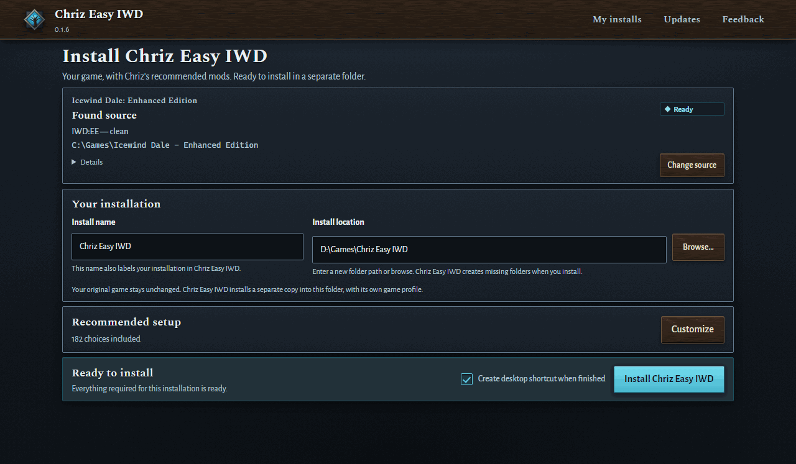

# Chriz Easy IWD

A one-click Windows installer and launcher for ChrizFader's curated **Icewind Dale: Enhanced Edition** setup (**145 default components across 34 install runs and 33 mods**, with **18 recruitable companions** in app `v0.1.16` / collection `0.1.17`).

- **Player Guide & Downloads:** **[bg.chrizfader.org/iwd](https://bg.chrizfader.org/iwd)**
- **Rules & Balance Changes:** **[bg.chrizfader.org/rules#iwd](https://bg.chrizfader.org/rules#iwd)**
- **Download Installer:** **[Latest Release](https://github.com/Chrizhermann/chriz-easy-iwd/releases/latest)**

---

## Part 1: For Players

  

Chriz Easy IWD copies your own clean **Icewind Dale: Enhanced Edition** into a new folder and downloads, verifies, and installs every selected mod from its official source in tested order. Your original game and saves remain untouched.

### What You Need

- **64-bit Windows 10 or 11** and an internet connection during installation.
- **Icewind Dale: Enhanced Edition 2.7.3.0**, ideally clean and unmodded. Tested with the English Steam version; other usable Windows copies install as **Less tested**, and a game that looks modded asks once before anything is copied. Mods install in English.
- **About 8–9 GB of free space** (the modded copy takes ~4–5 GB, downloaded mods ~2 GB, ~9 GB preflight estimate) on **NTFS, exFAT, or FAT32** drives.

### Quick Install Guide

1. **Download and open Chriz Easy IWD** from [bg.chrizfader.org/iwd](https://bg.chrizfader.org/iwd) or [Latest Release](https://github.com/Chrizhermann/chriz-easy-iwd/releases/latest). Close the game and any save editors first.
2. **Confirm source & destination:** Check the detected game folder (or use **Change source**), pick an **Install name**, and choose a new, empty **Install location** separate from your game, Steam library, and download cache.
3. **Recommended or Customize:** Keep the recommended setup, or choose **Customize** to pick an interface, add quests, or review optional components (manual-mod pauses are for experienced modders).
4. **Click Install Chriz Easy IWD:** Keep the computer awake. Need a break? Choose **Pause after current mod** and resume later from **My installs**.
5. **Click Play Chriz Easy IWD:** The modded copy uses its own isolated profile in Documents so its saves stay separate from your original game.

### Gameplay Highlights & App Features

- **Smarter fights & campaign overhaul:** **Sword Coast Stratagems** improves enemy tactics, potion use, elementals, and spells (adding 9 arcane and 6 divine spells). **Chriz IWD Encounters** (`v0.3.1`) fixes missed casters, prepares priests on sight (Core+), overhauls Chapters 2–6 (trimmed filler, paced Kresselack waves, repaired Terikan/Tarnsen/Ginafae scripts, Severed Hand/Giant/Wyrm upgrades, five elite squads), and upgrades twelve bosses (from the Kuldahar orog raid to **Belhifet**, keeping his original `BELHIFET` appearance). All creatures have maximum HP, and spells from high-level casters are harder to save against.
- **18 companions & party dialogue:** NPCs by The Artisan, Arvendor, and Lava with **Crossmod Banter Pack** (crash-guarded to living partners in the same area; Arszyk's Wonderful Decay is a beta for new installs). **Chriz IWD Party Dialog** lets living party members in the area speak for class, kit, and race checks in world/quest dialogue.
- **Characters, spells & Round Clock:** **Round Clock** tracks travel, rest, and time jumps toward cooldowns and Contingency checks and enables Stealth clicks while paused. Un-nerfed progressions, max HP per level, true grandmastery, open kit races, dual/multi backstabs, Klatu armor thieving, reader-level scrolls, no XP cap, innate sequencers, BG-style Insect Plague/Dispel/Minor Spell Deflection rules, wider wizard scroll availability, and unidentified potions.
- **Quality of life & visuals:** **Bubb's Spell Menu Extended**, **BuffBot** (`F11`), **Chriz Overhead Text** (keeps spoken lines stacked above Tab nameplates and HP Over Head), **EEex** (Left-Shift spell overview, grey empty containers, cooldown timers, UI scaling), **Icewind Dale Graphical Overhaul**, **Hidden Gameplay Options**, bottomless bags/unlimited stacks, 15-minute rotating autosaves, and dialogue pause.
- **Optional in Customize:** **Lefreut's Enhanced UI** or **Infinity UI++**; 8 **Lava** quest mods (incl. *Will of the Wisps*); **Heart of Winter & Trials of the Luremaster** expansion overhaul (`500`); **Marketh's Ring** (off by default due to a quest vanish risk); extra Tweaks/SCS/Banter/HGO picks; and **EEex Remote Console**.
- **Built-in updater & safe recovery:** Separate copy on NTFS/exFAT/FAT32; exact SHA-256 verification and guided prompts on changed downloads or failed steps; **Pause & resume** via **My installs**; **Updates → Hotpatch** (save-compatible campaign fixes & banter guard), **Updates → BuffBot** (with backup and **Undo**), **Update Chriz Easy IWD app**, optional **Manual mods**, and optional **BG Radar Overlay**.

---

## Part 2: Mod List, Limitations, Source & License

### Mods & Credits

Mod credit belongs to the original authors. Chriz Easy IWD does not supply the game or redistribute mod archives.

<strong>Full Mod List & Credits (33 recommended + 11 optional mods)</strong>

| Mod | Author | Version | Recommended setup |
| --- | --- | --- | --- |
| Enhanced Edition Fixpack | Gibberlings3 | Beta 2 | yes |
| EEex | Bubb | 1.3.1 | yes |
| Bubb's Spell Menu Extended | Bubb | 5.2 | yes |
| Icewind Dale Graphical Overhaul | Weigo (Spellhold Studios) | 1.1 + fixes (fda64de) | yes |
| Unfinished Business for Icewind Dale | Gibberlings3 | 13 | yes |
| Minerva | The Artisan | 1.1 | yes |
| Karihi | The Artisan | 1.02 | yes |
| Athanasios | The Artisan | 1.0 (035784e) | yes |
| Guldruk | The Artisan | 1522ddb | yes |
| Nirik | The Artisan | 2a1e9a9 | yes |
| Cassia | Arvendor | 1.05 beta (8f9af4c) | yes |
| Bethany | Lava | 1.03 | yes |
| Dendjelion | Lava | 2.1 | yes |
| Dusky | Lava | 2.5 | yes |
| Hommet | Lava | 1.2 | yes |
| Ina | Lava | 2.5 | yes |
| L'anna | Lava | 1.8 | yes |
| Oak-Maw | Lava | 3.3 | yes |
| Orra | Lava | 2.7 | yes |
| T'viy | Lava | 2.4 | yes |
| Urchin | Lava | 2.5 | yes |
| Vito | Lava | 1.1 | yes |
| Arszyk's Wonderful Decay | Lava | BETA1.4 | yes |
| Icewind Dale Crossmod Banter Pack | The Artisan, Arvendor, Kulyok, Lava | 5 | yes |
| The Tweaks Anthology | Gibberlings3 (CamDawg et al.) | 18 + fixes (7649ced) | yes |
| Sword Coast Stratagems | DavidW | 35.21 | yes |
| Chriz IWD Encounters | ChrizFader | 0.3.1 | yes |
| Hidden Gameplay Options | argent77 | 5.2 | yes |
| Klatu Tweaks and Fixes | Klatu (The Gate Project) | 1.7.4 | yes |
| BuffBot | ChrizFader | 1.16.2 | yes |
| Chriz Overhead Text | ChrizFader | 0.1.0 | yes |
| Chriz IWD Party Dialog | ChrizFader | 0.1.0 | yes |
| BG Rebalance | ChrizFader | 0.8.12 | yes |
| Lefreut's Enhanced UI for IWD:EE | lefreut; IWD:EE port by r-e-d | 2.0 | optional |
| Infinity UI++ | Pecca | 1.31 | optional |
| Will of the Wisps | Lava | 3.6 | optional |
| Below & Below Inn | Lava | 3.1 | optional |
| Night of the Blinking Dead | Lava | 3.1 | optional |
| Snowytoes Hamlet | Lava | 1.7.1 | optional |
| Tale of Our Lady Dreamless | Lava | 2.7 | optional |
| Terror of the Skineater | Lava | 2.6 | optional |
| The Rediscovery of Kuldahar | Lava | 2.6.1 | optional |
| The War of Bloom and Rot | Lava | 1.3 | optional |
| EEex Remote Console | ChrizFader | 0.2.1 | optional |

The BG Radar Overlay is by tapahob. Fonts and other third-party notices ship with the app.

### Known Limitations

- **Early release:** Not every combination of optional choices in **Customize** has been playtested.
- **Game source:** Only the English Steam version of IWD:EE `2.7.3.0` is tested; other copies install as **Less tested**.
- **Windows unknown-publisher prompt:** The setup carries a verified Tauri/Minisign updater signature but no Windows Authenticode signature. Download only from **[bg.chrizfader.org/iwd](https://bg.chrizfader.org/iwd)** or this repository's **[Releases](https://github.com/Chrizhermann/chriz-easy-iwd/releases)** and compare the published SHA-256 checksum (`SHA256SUMS`).
- **Upstream mods:** Mods install as their authors released them.

### Help & Links

- **Player Guide, Troubleshooting & Downloads:** [bg.chrizfader.org/iwd](https://bg.chrizfader.org/iwd) · [Troubleshooting & Backup Guide](https://github.com/Chrizhermann/chriz-bg-collection/blob/main/docs/troubleshooting.md)
- **Questions & Bug Reports:** [ChrizFader's Discord](https://discord.gg/RtXjRzy68k) or [GitHub Issues](https://github.com/Chrizhermann/chriz-easy-iwd/issues). In the app, **Feedback** and **Report this problem** prepare a clean report, and **Export diagnostics** collects logs (with Windows user and PC names redacted).
- **Source Code:** [`Chrizhermann/chriz-bg-collection`](https://github.com/Chrizhermann/chriz-bg-collection) (shared with Chriz Easy BG) — see the [Windows build guide](https://github.com/Chrizhermann/chriz-bg-collection/blob/main/docs/BUILDING.md).

### License

The documentation and files in this repository — as well as Chriz Easy IWD's own installer, engine, and recipe tooling in [`chriz-bg-collection`](https://github.com/Chrizhermann/chriz-bg-collection) — are licensed under the **MIT License** (see [LICENSE](LICENSE)).

Third-party mods retain their original authors' rights and licenses and are **not** redistributed. Bundled app dependencies and fonts retain their respective terms; see [`THIRD_PARTY_NOTICES.md`](https://github.com/Chrizhermann/chriz-bg-collection/blob/main/THIRD_PARTY_NOTICES.md).
